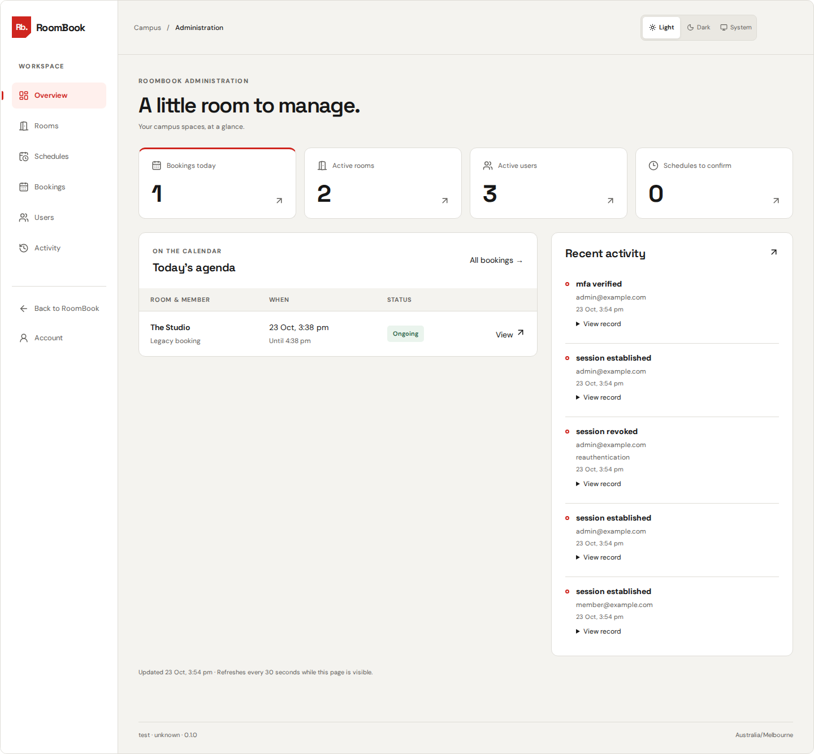
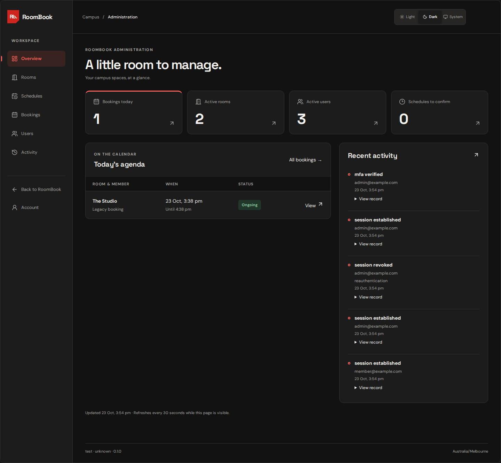
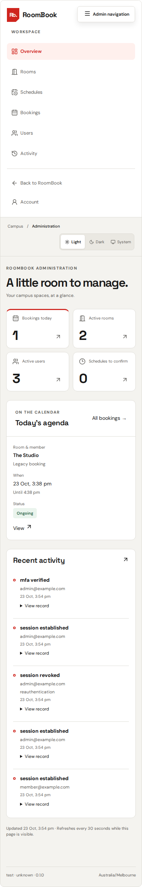
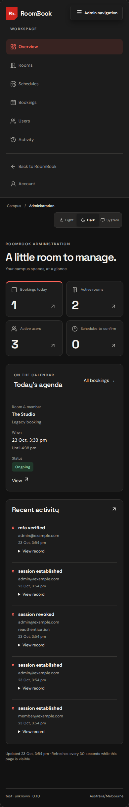

# Admin workspace verification

Local verification on 23 October 2026, based on `main` at `f30aa48` (including the team's RB-23 visitor-journey correction). The application uses real FastAPI routes, PostgreSQL, opaque sessions and generated clients. Only the external identity provider is replaced in the guarded browser fixture. No live environment was modified.

## Results

| Check | Result |
| --- | --- |
| Full backend suite | 479 passed; 94.98% combined coverage |
| Final admin backend regression after date-filter correction | 20 passed |
| Full frontend suite | 171 passed; 94.78% line coverage |
| Final admin/MFA frontend regression after API timestamp update | 19 passed |
| Admin browser journeys | 6 passed (five management journeys plus keyboard dialog check) |
| Authenticated room-booking browser regressions | 4 passed |
| Updated visitor booking journeys from `main` | 3 passed |
| Ruff lint/format and mypy, including tests | Passed |
| Frontend formatting, ESLint, TypeScript and production build | Passed |
| OpenAPI export and generated TypeScript client drift | Passed |
| Alembic schema/model drift | No new upgrade operations |
| Changed GitHub workflows | Passed pinned actionlint 1.7.12 |

The first final run overloaded the local machine by running full coverage suites and browser tests together: five frontend waits and one browser MFA wait timed out. Running coverage with two workers and the browser suites sequentially passed without increasing timeouts. The subsequent clean admin browser run used a fresh dedicated database. The visitor regressions used the local booking fixture with its synthetic weekend hours removed to match the pipeline's weekday calendar. The build retains Vite's main-chunk size advisory; administration routes are separately lazy-loaded.

## What was exercised

- Guests and members cannot enter the admin API; active Admin plus verified TOTP is required. Origin/CSRF, revoked sessions, recent step-up, wrong/unowned factors and provider failures are covered.
- Enrollment clears the setup secret after verification. Factor removal revokes sessions even on an uncertain result. The last verified admin factor and last active admin are protected. Refresh cannot extend the MFA timestamp; a revoked session cannot be resurrected by verification.
- Create inactive room → confirm schedule → activate; complete weekly windows, date overrides and closures; overlap/DST validation; optimistic revisions; preview impact and a booking arriving between preview and save.
- Upcoming/ongoing cancellations, unchanged completed bookings, cancelled bookings combined with a date filter, legacy ownership and allowlisted audit history. User suspension revokes real local sessions while retaining existing reservations.
- Lost successful save response reuses the same mutation key and recovers one result. Inline MFA keeps the proposed access change and reason, then requires another explicit confirmation.
- Overview, all six sections, light/dark appearance, keyboard-operated confirmation dialogs, mobile navigation, no horizontal overflow and mobile tables. Existing room-slot selection, sign-in boundary, receipt refresh, competing booking and uncertain-outcome retry still pass.
- Additive migration preserves an existing booking; downgrade refuses to discard mutation receipts. First-admin bootstrap was tested only against isolated data.

## Browser evidence

All displayed accounts and reservations below are synthetic local fixtures. The expanded mobile menu is intentional so every navigation destination can be inspected.

| Desktop light | Desktop dark |
| --- | --- |
|  |  |

| Mobile light | Mobile dark |
| --- | --- |
|  |  |

## Reproduce and release

The commands and database setup for browser checks live in `.github/workflows/admin.yml` and `.github/workflows/room-booking.yml`. Both require dedicated empty loopback databases ending `_e2e_test`; the test provider and fixture endpoints are excluded from the production image. Backend database tests require a separate `_test` database. Use `npm run test:coverage -- --maxWorkers=2` for the constrained local machine.

PR checks and the existing candidate pipeline gate include the new admin journeys. Follow [the workspace rollout guide](workspace.md#rollout-checklist) for the additive migration, controlled Staging accounts, actual Supabase TOTP settings, confirmed room hours, audit evidence and first-admin setup. Local fixture success does not verify those live settings or constitute deployed acceptance.
